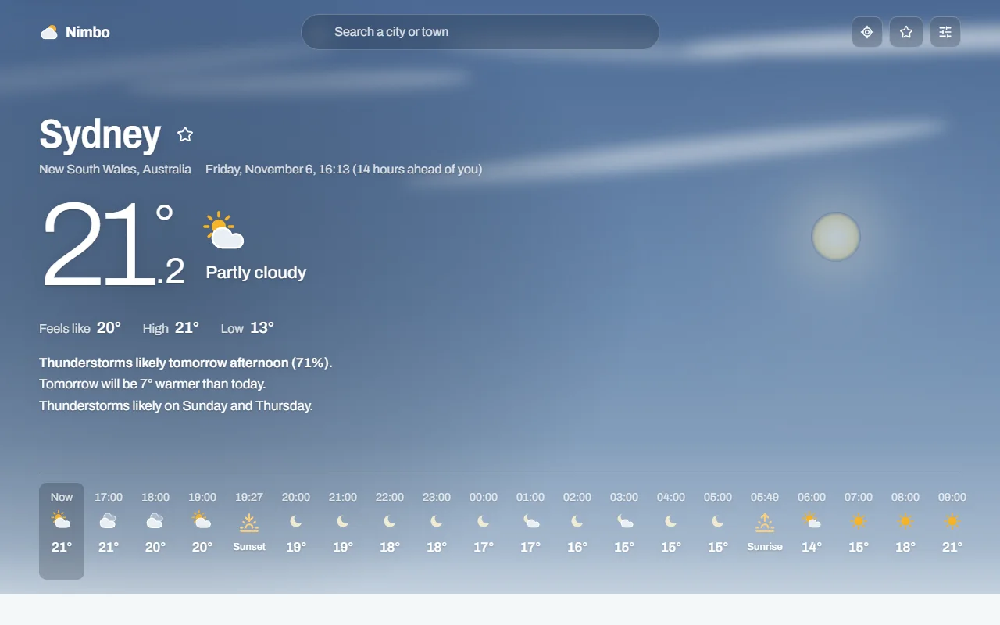

# Nimbo

A weather app that tells you a lot about any place in the world: the sky right now, hour by hour and day by day, air quality, sun and moon, how this season compares with the last 30 years, what each weather model says, and the rain radar. No sign-up needed.

**[Open Nimbo](https://nimbo.fsucatti-portfolio.workers.dev)**



Built by **Francisco Sucatti**.

## Getting started

Nimbo opens on your approximate area. To see another place:

- **Search:** type a city or town in the box at the top and pick it from the list. The arrow keys and Enter work too.
- **Your location:** the target button asks your browser for your position, for a more precise forecast.
- **The map:** click any point on the radar map and choose **Show the weather here**.

The address bar always holds the place you're looking at, so you can bookmark it or send it to someone.

## What you'll find

| Section | What it shows |
|---|---|
| **The sky** | The current reading over a sky drawn from real data: where the sun or moon is, cloud at three heights, stars, rain or snow. A short summary says what's coming |
| **Worth knowing** | Notable weather in the next days, such as storms, heavy rain, strong gusts, frost or very high UV. These are not official warnings |
| **Hour by hour** | The next 3 hours in 15-minute steps, then a meteogram of up to 15 days: temperature, rain, wind, clouds, humidity, pressure, UV and visibility on one timeline |
| **Days** | Lows and highs on a shared scale. Open a day for its hours, sunshine, wind, UV and more |
| **Right now** | Wind with a compass, a barometer with the pressure trend, UV, humidity and dew point, visibility, cloud layers, storm potential and the ground |
| **Air quality** | US and European indexes, pollutants compared with WHO guidelines, five days ahead, and pollen in Europe |
| **Sun and moon** | Twilight and golden hours, both paths across today's sky, the moon's phase and its next phases, and daylight through the year |
| **Plan your day** | The best hours to be outside, go for a run, dry laundry, look at the stars or photograph the sunset |
| **Compared with normal** | The last 30 days and the next 15 against the 1991–2020 average for each date, with records for today's date |
| **Models** | Nine weather models side by side, and how much they agree |
| **Rain radar** | The last two hours of radar, with a play button |
| **At sea** | For coastal places: waves, swell, water temperature, currents and tides |

### Reading the charts

- On the hour-by-hour chart, move the pointer or your finger along it. With the keyboard, focus the chart and use the arrow keys. The values for that hour appear above it.
- The chips above the chart turn its rows on and off.
- Every chart has a **Show table** button with the same numbers.

## Settings

The sliders button sets the units (°C or °F, km/h, m/s, mph or knots, mm or inches, hPa, inHg or mmHg, km or miles) and a 12- or 24-hour clock.

By default, the page is light while it's day at the place you're viewing and dark while it's night there. You can also follow your device or choose always light or always dark.

The star next to a place's name saves it. Saved places appear under the star at the top, with their weather now.

## Your data

- Settings and saved places stay in your browser.
- On your first visit, your approximate area is estimated from your connection to choose the starting place. Nothing is stored.
- **Use my location** and map clicks send coordinates to the services that name places and provide the weather.

## Data sources

- Weather, air quality, sea, history and geocoding: [Open-Meteo](https://open-meteo.com/) (CC BY 4.0), built on data from national weather services.
- Air quality: Copernicus Atmosphere Monitoring Service. Climate history: Copernicus Climate Change Service (ERA5).
- Radar: [RainViewer](https://www.rainviewer.com/). Map: [OpenFreeMap](https://openfreemap.org/), © OpenMapTiles, © OpenStreetMap contributors.
- Place names: [GeoNames](https://www.geonames.org/) and [Nominatim](https://nominatim.org/).
- Sun and moon: calculated in the browser with [SunCalc](https://github.com/mourner/suncalc).

These services are free and ask for fair use. If you see a message about too many requests, wait a minute and try again.

**Built with:** React, TypeScript, TanStack Query, D3, MapLibre, Vite and Cloudflare Workers.

## Run it locally

You need Node.js 22 or later.

```bash
npm install
```

```bash
npm run preview
```

Then open <http://localhost:8787>.

| Command | What it does |
|---|---|
| `npm run dev` | Development server with live reload, at <http://localhost:5173> |
| `npm test` | Tests the weather logic |
| `npm run test:e2e` | Tests in the browser with saved data. On Windows these use Microsoft Edge |

To change colors, rules or sections, see [how to customize Nimbo](docs/CUSTOMIZING.md).
